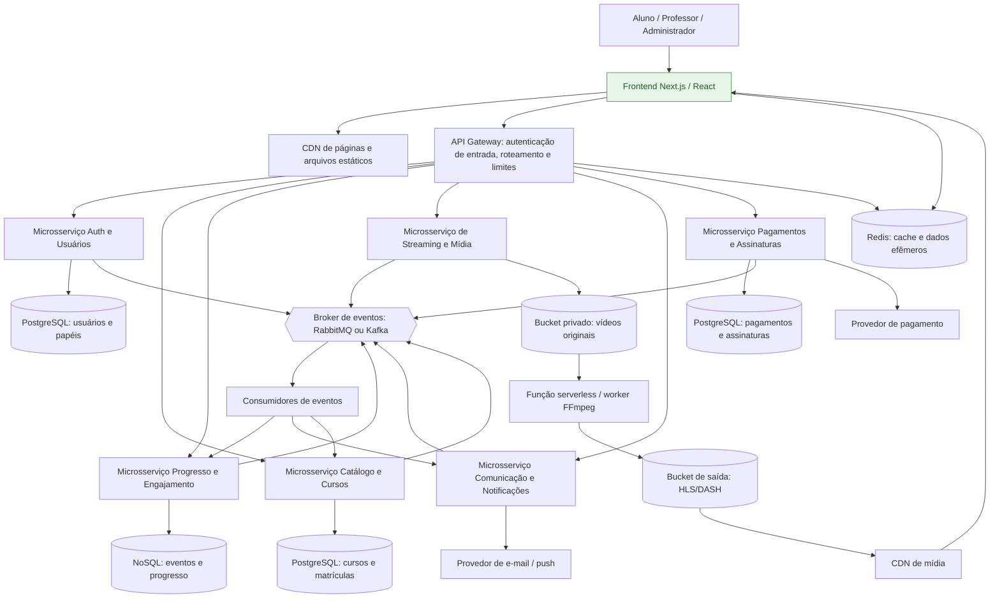

# Arquitetura do Estudaí — proposta para a atividade

## 1. Objetivo e estado de implementação

A atividade acadêmica solicita uma arquitetura de **microsserviços orientada a eventos (Event-Driven Microservices)** combinada com **serverless** para componentes de alta demanda.

O repositório atual é um frontend Next.js/React. A inspeção dos arquivos e dependências não identificou serviços backend independentes, broker de mensagens, banco de dados de servidor ou infraestrutura de streaming integrada. Portanto, o desenho abaixo é uma **arquitetura-alvo proposta**, não uma afirmação de que esses componentes já estão implantados.

## 2. Diagrama estrutural da solução proposta

O diagrama pode ser visualizado pelo GitHub por meio do Mermaid.

**Legenda:** o frontend Next.js é o componente existente identificado no repositório. Os demais componentes são elementos propostos para a arquitetura-alvo e precisam ser desenvolvidos, configurados e testados antes de serem considerados implementados.

## 3. Microsserviços por domínio

| Serviço | Responsabilidades | Dados principais | Eventos publicados/consumidos |
|---|---|---|---|
| Auth e Usuários | Cadastro, login, sessões, papéis RBAC e permissões | PostgreSQL | `UserRegistered`, `UserRoleChanged` |
| Catálogo e Cursos | Cursos, módulos, aulas, trilhas, materiais e matrículas | PostgreSQL e armazenamento de objetos para materiais | `CoursePublished`, `EnrollmentGranted` |
| Progresso e Engajamento | Progresso por aula, tempo assistido, conclusão e certificados | PostgreSQL para registros transacionais; NoSQL opcional para eventos de alto volume | `LessonProgressUpdated`, `CourseCompleted`, `CertificateIssued` |
| Streaming e Mídia | Upload autorizado, metadados, processamento, transcodificação e entrega | Banco de metadados e bucket de objetos | `MediaUploaded`, `TranscodingRequested`, `MediaReady`, `TranscodingFailed` |
| Comunicação e Notificações | E-mail, push e avisos de prazos ou novas aulas | Preferências e histórico de notificações | Consome eventos de matrícula, publicação, prazos e pagamentos |
| Pagamentos e Assinaturas | Planos, cupons, cobranças, reembolsos e renovação | PostgreSQL; integração com provedor de pagamento | `PaymentApproved`, `PaymentFailed`, `SubscriptionChanged`, `RefundProcessed` |

Cada serviço deve ser dono dos seus dados e expor contratos claros. Evitar que serviços leiam ou alterem diretamente as tabelas internas uns dos outros.

## 4. Fluxos orientados a eventos

### Exemplo A — pagamento aprovado e liberação de curso

1. O serviço de Pagamentos recebe a confirmação assinada do provedor.
2. Valida o webhook e registra a transação de forma idempotente.
3. Publica `PaymentApproved` no broker.
4. O serviço de Catálogo/Matrículas consome o evento e concede acesso ao curso.
5. O serviço de Notificações consome o evento e envia a confirmação ao aluno.
6. O serviço de Progresso inicializa o registro de acompanhamento, se necessário.

O processamento assíncrono evita acoplar a resposta do pagamento a todos os demais serviços. Eventos devem conter identificador único, versão do esquema, data, identificador do agregado e apenas os dados necessários.

### Exemplo B — publicação de vídeo

1. O cliente solicita ao serviço de Mídia uma autorização de upload.
2. O vídeo bruto é enviado diretamente a um bucket privado por URL assinada.
3. O evento `MediaUploaded` solicita o processamento.
4. Um worker ou função serverless executa FFmpeg ou um serviço gerenciado de transcodificação.
5. São geradas variantes de qualidade e segmentos HLS/DASH.
6. O serviço publica `MediaReady`; a CDN distribui os segmentos aos alunos.
7. Em caso de falha, publicar `TranscodingFailed`, registrar a causa e permitir retentativa controlada.

### Exemplo C — progresso de aula

1. O player envia eventos de progresso com frequência limitada.
2. O serviço de Progresso valida matrícula e registra o avanço.
3. Ao completar uma aula ou curso, publica `LessonCompleted` ou `CourseCompleted`.
4. Notificações podem avisar o aluno; o serviço de Certificados valida os critérios e emite o certificado.

## 5. Tecnologias recomendadas por camada

| Camada | Opção proposta | Justificativa |
|---|---|---|
| Frontend | Next.js / React (já utilizado) | Interface responsiva e renderização web |
| API Gateway | AWS API Gateway ou Kong | Roteamento, limites, autenticação de entrada e observabilidade |
| Mensageria | RabbitMQ ou Apache Kafka | Comunicação assíncrona e desacoplamento |
| Dados transacionais | PostgreSQL | Consistência de usuários, matrículas e financeiro |
| Dados flexíveis/alto volume | MongoDB ou DynamoDB, conforme necessidade | Eventos de progresso e leitura de alto volume |
| Cache | Redis | Cache de consultas e dados efêmeros; não deve ser a fonte principal de verdade |
| Objetos | S3 ou serviço compatível | Upload e armazenamento de vídeos e materiais |
| Transcodificação | FFmpeg em worker ou serviço gerenciado | Geração de variantes de vídeo |
| Distribuição | CloudFront ou Cloudflare CDN | Cache de segmentos e redução de latência |
| Serverless | Funções acionadas por eventos, filas e jobs | Processamento elástico de tarefas com demanda variável |
| Observabilidade | Logs estruturados, métricas, traces e alertas | Diagnóstico de falhas entre serviços |

Essas tecnologias são alternativas arquiteturais, não dependências já presentes no projeto.

## 6. Estratégia serverless

Usar serverless principalmente para tarefas de demanda variável e processamento em lote:

- geração de notificações acionadas por eventos;
- processamento de webhooks;
- tarefas curtas de geração/validação de conteúdo;
- consumidores de filas e atualização de estatísticas;
- disparo e orquestração de jobs de transcodificação.

A transcodificação de vídeos longos pode exceder limites de duração ou memória de funções serverless. Nesses casos, usar serviço gerenciado de mídia ou workers em contêineres, acionados por fila e escalados conforme o tamanho da fila. Não executar transcodificação pesada dentro da requisição HTTP do frontend.

## 7. Requisitos transversais

- **Segurança:** RBAC no servidor, sessão segura, validação de entradas, proteção contra abuso, segredos em cofre de credenciais e URLs assinadas para mídia privada.
- **Consistência:** operações financeiras transacionais; consumidores idempotentes; padrão outbox quando for necessário publicar eventos sem perder a consistência entre banco e broker.
- **Resiliência:** timeouts, retentativas com backoff, dead-letter queue, tratamento de duplicidade e circuit breaker onde aplicável.
- **Observabilidade:** correlation ID, logs estruturados, métricas de latência/erro e rastreamento distribuído.
- **Privacidade:** coletar apenas os dados necessários, definir retenção e proteger dados pessoais.
- **Operação:** backups testados, migrações versionadas, health checks e procedimento de recuperação.

## 8. Matriz de aderência entre a atividade e o repositório atual

| Exigência | Situação no repositório analisado | Próxima entrega técnica necessária |
|---|---|---|
| Frontend React/Next.js | Presente | Manter e integrar com APIs reais |
| Serviço Auth com RBAC | Não identificado como backend real | Criar serviço, persistência e testes de autorização |
| Catálogo de cursos backend | Não identificado | Criar API e banco do catálogo |
| Progresso persistente no servidor | Dados da demonstração no navegador | Criar serviço e persistência |
| Serviço de mídia e upload | Não identificado | Implementar upload seguro, metadados e processamento |
| HLS/DASH e CDN | Não identificado | Pipeline de transcodificação e distribuição |
| Notificações reais | Não identificadas | Criar serviço e integrar provedor |
| Pagamentos reais | Não identificados; Estudaí+ é prévia | Integrar provedor, webhooks e controles financeiros |
| Broker e eventos | Não identificados | Provisionar RabbitMQ/Kafka, contratos e consumidores |
| API Gateway | Não identificado | Configurar gateway e roteamento |
| PostgreSQL, NoSQL e Redis | Não identificados como infraestrutura conectada | Provisionar serviços e definir propriedade dos dados |
| Serverless | Não identificado como componente implantado | Implantar funções/jobs acionados por eventos |
| Documentação e diagrama | Documentação adicionada neste arquivo | Atualizar conforme a implementação real evoluir |

## 9. Plano de implementação sugerido

1. Definir contratos de API, modelos de dados e esquemas de eventos.
2. Criar infraestrutura local reproduzível com Docker Compose para PostgreSQL, RabbitMQ e Redis.
3. Implementar primeiro Auth e Catálogo, com migrações, testes e controle de acesso.
4. Implementar matrícula e progresso com eventos idempotentes.
5. Implementar mídia com bucket, upload assinado, transcodificação e CDN.
6. Integrar notificações e pagamentos em ambiente de testes.
7. Implantar funções/jobs serverless e observabilidade.
8. Executar testes de integração, segurança, carga e recuperação; atualizar este documento para refletir o que estiver realmente implantado.

## 10. Referências internas

- [README do projeto](../README.md)
- [Relatório operacional](relatorio-operacional.md)
- [Validação do frontend](validacao.md)
- [Contrato de integração do quiz](quiz-integracao.md)
